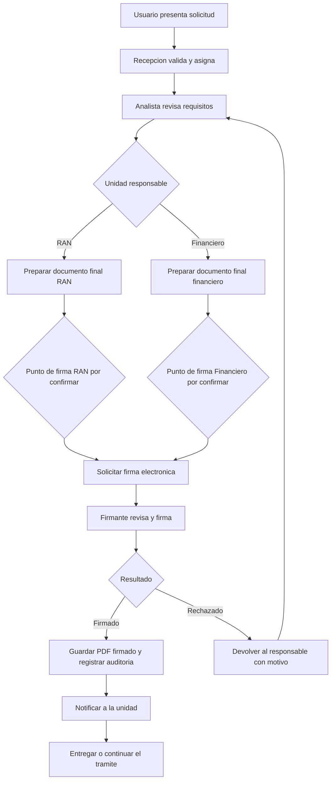

# FORMATO DE DEFINICION DEL FLUJO DE FIRMA ELECTRONICA

**Unidades:** Registro Aeronautico Nacional (RAN) y Departamento Financiero  
**Objetivo:** Definir en que punto del tramite debe solicitarse la firma electronica, quien la solicita, quien firma y como continua el proceso.

> Este documento es para levantamiento y validacion funcional. Los ejemplos son propuestas y no representan una decision aprobada.

## 1. Diagrama general propuesto

## 2. Punto exacto donde debe aparecer el modulo

Marque una opcion por cada unidad o describa otra alternativa.

| Opcion | Momento de solicitud de firma | RAN | Financiero |
|---|---|:---:|:---:|
| A | Cuando el analista termina la revision y genera el PDF final | ☐ | ☐ |
| B | Cuando el aprobador abre el documento para aprobar | ☐ | ☐ |
| C | Inmediatamente despues de que el aprobador autoriza el tramite | ☐ | ☐ |
| D | Cuando el emisor prepara el documento definitivo | ☐ | ☐ |
| E | Otro momento, descrito por la unidad | ☐ | ☐ |

**Descripcion de otro momento:**  
______________________________________________________________________________  
______________________________________________________________________________

## 3. Ficha que debe completar cada unidad

### 3.1 Identificacion

| Campo | Respuesta |
|---|---|
| Unidad | ☐ RAN  ☐ Financiero |
| Nombre del tramite | |
| Responsable que proporciona la informacion | |
| Fecha de validacion | |

### 3.2 Documento y responsables

| Pregunta | Respuesta requerida |
|---|---|
| ¿Que documento se firma? | Nombre exacto del PDF o documento final |
| ¿Quien prepara o carga el documento? | Rol y unidad |
| ¿Quien solicita la firma? | Rol autorizado |
| ¿Quien debe firmar? | Rol, puesto o persona responsable |
| ¿Se necesita mas de una firma? | Si/No; indicar orden si aplica |
| ¿Puede firmar un sustituto? | Si/No; indicar bajo que condicion |
| ¿En que pagina debe aparecer la firma? | Numero de pagina o ultima pagina |
| ¿En que posicion debe aparecer? | Superior/inferior; izquierda/centro/derecha |

### 3.3 Reglas del flujo

| Pregunta | Respuesta requerida |
|---|---|
| Estado anterior a solicitar firma | Ej.: Aprobado pendiente de firma |
| Estado mientras se firma | Ej.: Firma solicitada |
| Estado cuando la firma finaliza | Ej.: Firmado |
| ¿Que sucede despues de firmar? | Entrega, notificacion o siguiente responsable |
| ¿Que sucede si se rechaza la firma? | A quien regresa y que puede corregirse |
| ¿Que sucede si el servicio no responde? | Esperar, reintentar o escalar |
| ¿Se permite cancelar una solicitud de firma? | Si/No; indicar rol autorizado |
| ¿A quienes se notifica por correo? | Solicitante, firmante, analista u otros |

### 3.4 Acceso y auditoria

| Pregunta | Respuesta requerida |
|---|---|
| Roles que pueden ver el modulo | |
| Roles que pueden solicitar firma | |
| Roles que pueden consultar el documento firmado | |
| Roles que pueden descargar el documento | |
| Datos que deben aparecer en el historial | Fecha, usuario, estado, motivo, etc. |

## 4. Ejemplo propuesto para RAN

> Ejemplo sujeto a confirmacion de RAN.

1. Recepcion asigna la solicitud a un analista RAN.
2. El analista revisa los requisitos y carga o genera el PDF final.
3. El analista envia el proceso al aprobador.
4. El aprobador autoriza el tramite.
5. El sistema habilita **Solicitar firma electronica**.
6. El firmante revisa el PDF y firma mediante el proveedor configurado.
7. El sistema conserva el PDF firmado, registra la auditoria y notifica a RAN.
8. Recepcion entrega el documento al solicitante.

**RAN debe confirmar:**

- Si el aprobador tambien es el firmante.
- Si la firma ocurre antes o despues de aprobar.
- Quien puede devolver el documento para correccion.
- Pagina y posicion de la firma.
- Quien realiza la entrega final.

## 5. Ejemplo propuesto para Financiero

> Ejemplo sujeto a confirmacion del Departamento Financiero.

1. El analista financiero revisa la solicitud.
2. El analista traslada el expediente al emisor.
3. El emisor prepara el documento financiero definitivo.
4. El aprobador autoriza el contenido.
5. El proceso regresa al emisor o al firmante designado, segun lo que confirme Financiero.
6. El sistema habilita **Solicitar firma electronica**.
7. El firmante completa la firma y el sistema conserva el PDF firmado.
8. El sistema notifica al responsable para continuar o finalizar el proceso.

**Financiero debe confirmar:**

- Si firma el aprobador, el emisor o una jefatura.
- Si el pago debe estar aprobado antes de solicitar la firma.
- Si todos los tramites financieros requieren firma.
- Quien puede consultar y entregar el documento firmado.
- Que debe ocurrir cuando la firma es rechazada.

## 6. Flujo definitivo aprobado por la unidad

Complete esta secuencia usando nombres de roles y estados exactos.

| Paso | Responsable | Accion | Estado resultante | Notificacion |
|---:|---|---|---|---|
| 1 | | | | |
| 2 | | | | |
| 3 | | | | |
| 4 | | | | |
| 5 | | | | |
| 6 | | | | |
| 7 | | | | |
| 8 | | | | |

## 7. Criterios minimos para iniciar la implementacion

La unidad debe entregar como minimo:

- Punto exacto del flujo donde aparece **Solicitar firma**.
- Rol que solicita y rol que firma.
- Documento que se firma y ubicacion visual de la firma.
- Estados anterior, durante y posterior a la firma.
- Comportamiento ante rechazo, error o vencimiento.
- Destinatarios de notificaciones.
- Responsable de la entrega final.

## 8. Aprobacion funcional

| Unidad | Nombre y cargo | Decision | Fecha | Firma/Visto bueno |
|---|---|---|---|---|
| RAN | | ☐ Aprobado ☐ Con cambios | | |
| Financiero | | ☐ Aprobado ☐ Con cambios | | |
| Informatica | | ☐ Recibido para implementar | | |

