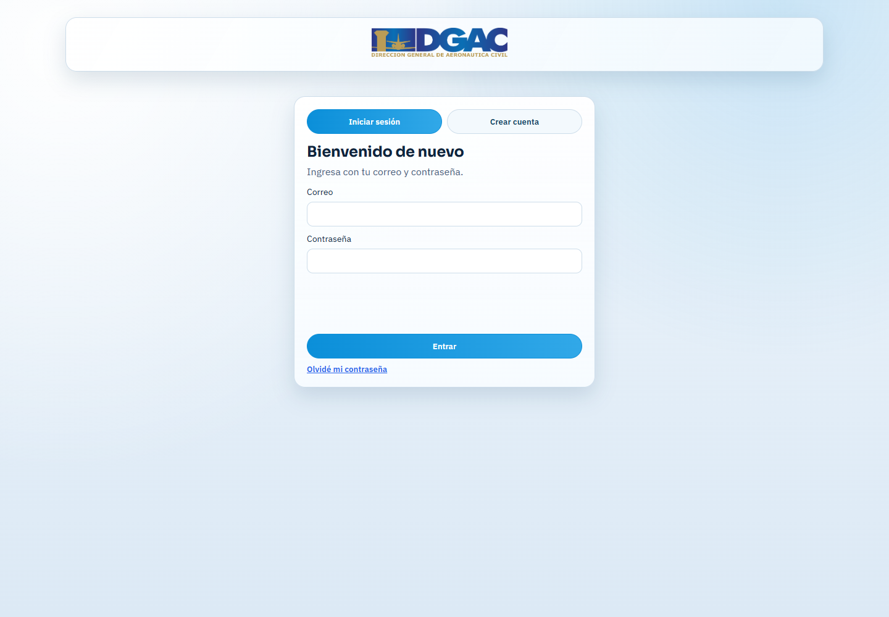
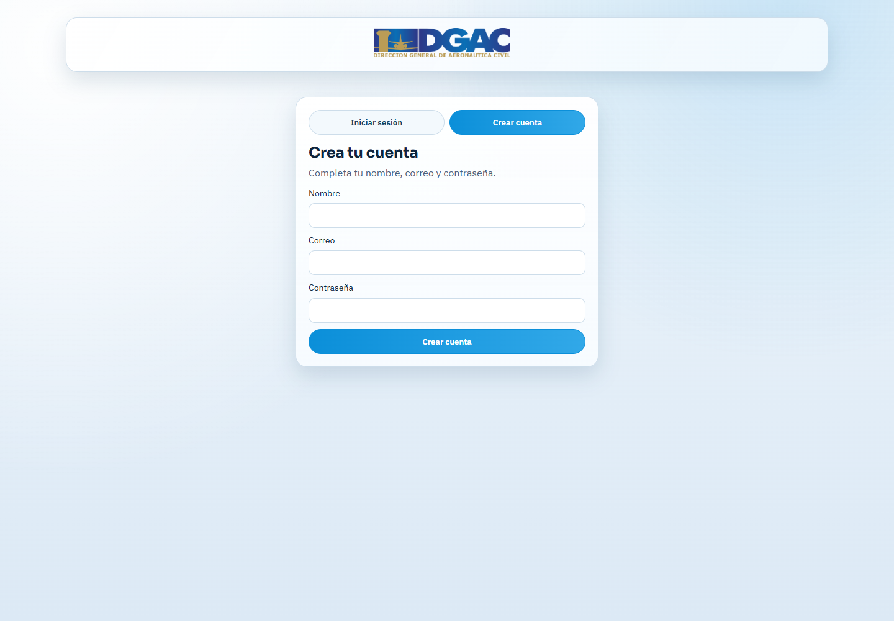
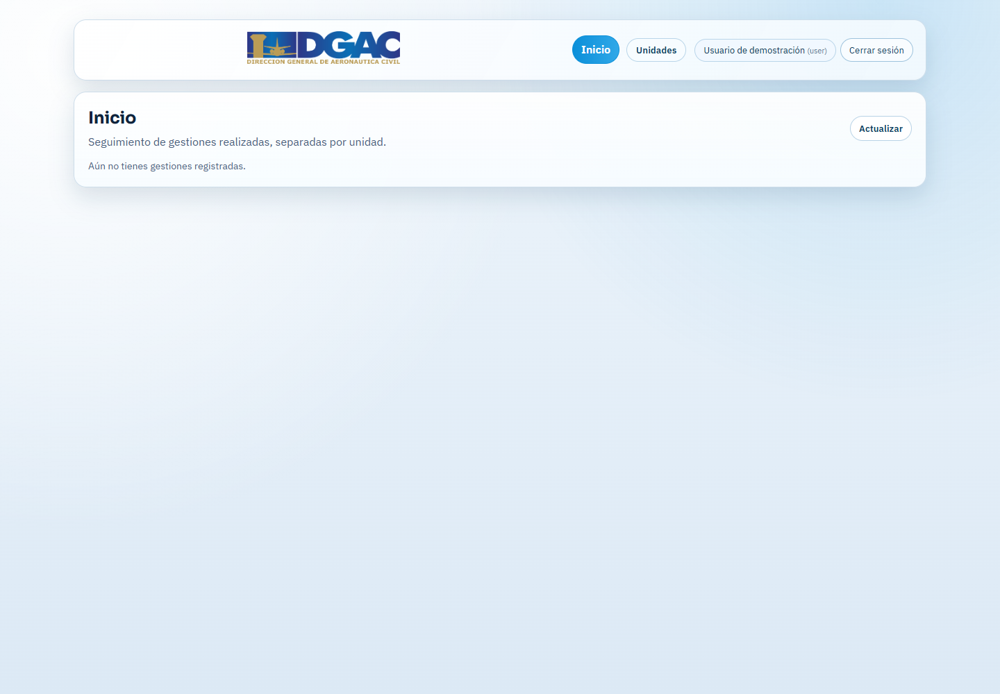
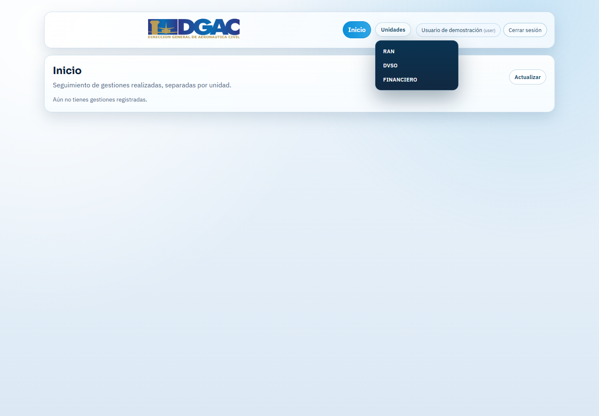
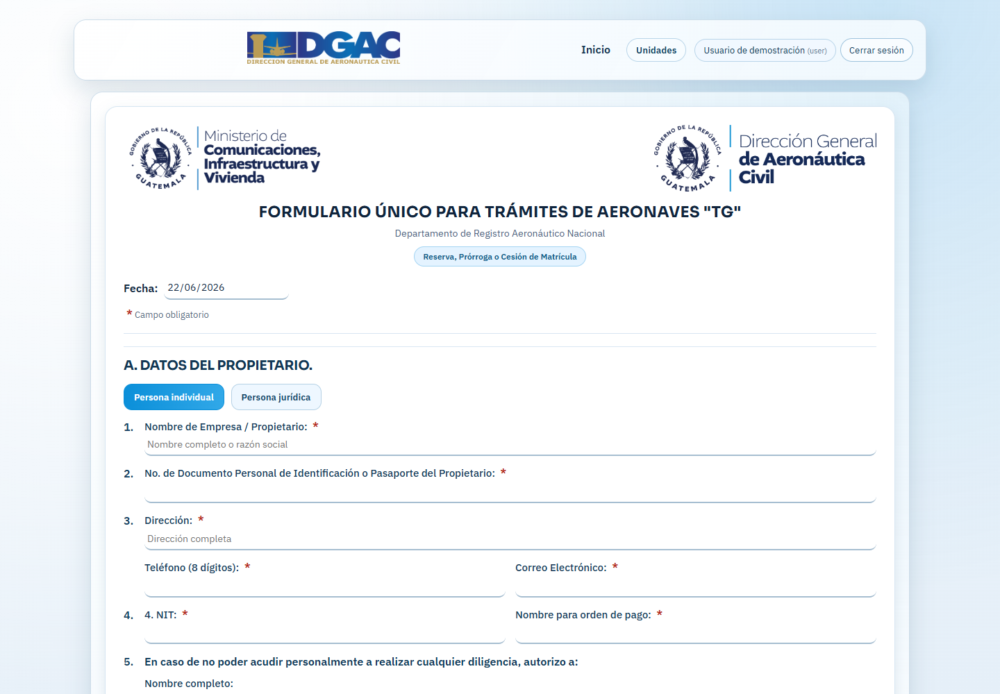
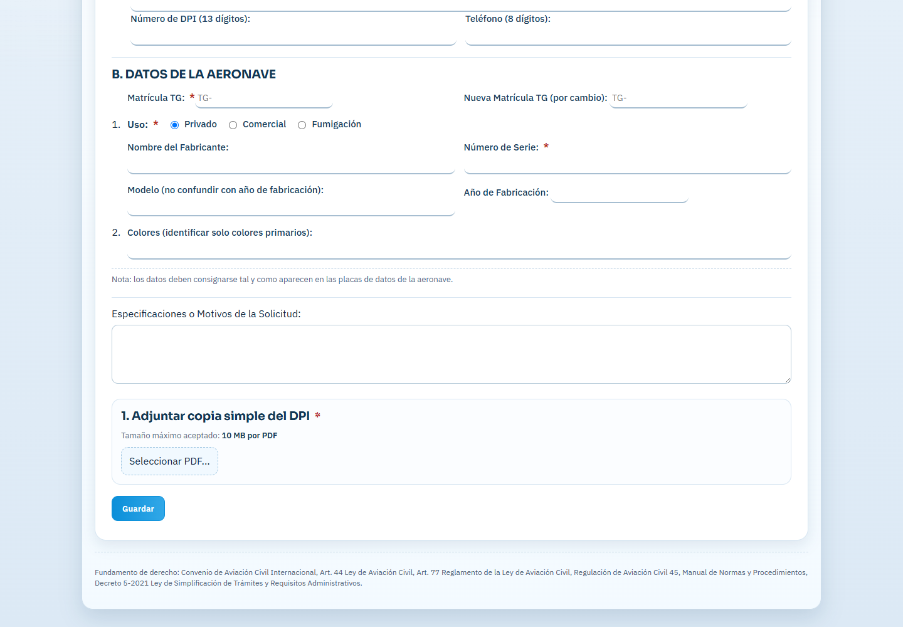
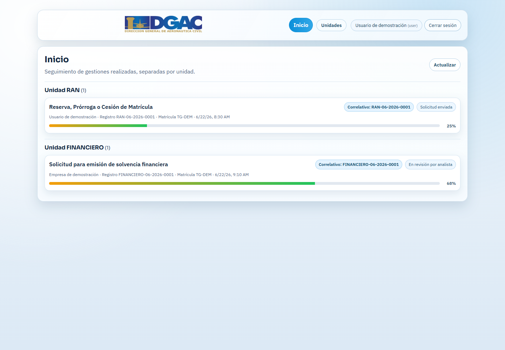

```{=openxml}
<w:p><w:r><w:br w:type="page"/></w:r></w:p>
```

# ÍNDICE

1. OBJETIVOS DE LA GUÍA

2. ALCANCE DE LA GUÍA

3. DEFINICIONES Y ACRÓNIMOS

4. BASE LEGAL

5. NORMAS PARA EL USO DEL PORTAL INSTITUCIONAL

6. GUÍA PARA EL USO DEL PORTAL INSTITUCIONAL DGAC

7. ANEXOS

8. RESOLUCIÓN DE APROBACIÓN DE LA GUÍA

```{=openxml}
<w:p><w:r><w:br w:type="page"/></w:r></w:p>
```

# 1. OBJETIVOS DE LA GUÍA

La presente guía tiene como objetivo orientar a los usuarios externos en el uso general del portal institucional de la Dirección General de Aeronáutica Civil -DGAC-, facilitando la identificación de sus apartados principales, funciones disponibles y mecanismos de consulta o seguimiento de servicios digitales.

Son objetivos específicos de esta guía:

1. Facilitar la familiarización del usuario externo con el portal institucional de la DGAC.
2. Explicar de forma general las funciones disponibles para consulta, registro, envío y seguimiento de gestiones.
3. Promover el uso correcto de la información institucional publicada en línea.
4. Reducir errores frecuentes durante el uso de los servicios digitales.
5. Indicar los datos mínimos recomendados para solicitar asistencia ante la unidad correspondiente.

# 2. ALCANCE DE LA GUÍA

Esta guía está dirigida a personas individuales, personas jurídicas, representantes, gestores y usuarios externos que consultan o utilizan servicios digitales publicados por la DGAC.

El alcance de la guía comprende:

- Navegación general dentro del portal institucional.
- Identificación de menús, unidades, apartados y servicios disponibles.
- Uso de funciones de acceso, consulta y seguimiento cuando estén habilitadas.
- Recomendaciones generales para completar información y adjuntar documentos.
- Orientación para atender correcciones o solicitar asistencia.

La presente guía no sustituye los requisitos técnicos, legales o administrativos específicos de cada trámite. Cuando un trámite cuente con instructivo, normativa, formulario oficial o procedimiento propio, prevalecerá la información publicada por la unidad responsable.

# 3. DEFINICIONES Y ACRÓNIMOS

| Término | Definición |
|---|---|
| DGAC | Dirección General de Aeronáutica Civil. |
| Portal institucional | Sitio web oficial de la DGAC donde se publica información institucional y servicios digitales. |
| Usuario externo | Persona individual o jurídica que consulta información o utiliza servicios digitales de la DGAC. |
| Servicio digital | Función del portal que permite realizar una consulta, solicitud o gestión en línea. |
| Trámite | Gestión administrativa o técnica presentada ante una unidad competente. |
| Correlativo | Código asignado por el sistema para identificar una solicitud. |
| Unidad responsable | Área de la DGAC encargada de revisar, atender o resolver una gestión. |
| Documento de soporte | Archivo requerido para respaldar la información presentada por el usuario. |
| Corrección | Ajuste solicitado por la unidad responsable cuando una gestión requiere subsanación. |
| Notificación | Mensaje enviado por el sistema para informar el estado o avance de una gestión. |

# 4. BASE LEGAL

La utilización del portal institucional y de los servicios digitales de la DGAC se enmarca en las disposiciones legales, reglamentarias y administrativas aplicables a la Dirección General de Aeronáutica Civil, así como en las normas internas que regulan la gestión documental, atención al usuario, simplificación de trámites y prestación de servicios institucionales.

La información específica de cada trámite deberá consultarse en la normativa, requisitos o documentos oficiales publicados por la unidad responsable.

```{=openxml}
<w:p><w:r><w:br w:type="page"/></w:r></w:p>
```

# 5. NORMAS PARA EL USO DEL PORTAL INSTITUCIONAL

Para el uso adecuado del portal institucional de la DGAC, el usuario externo deberá considerar las normas siguientes:

1. Verificar que se encuentra en un sitio oficial de la DGAC antes de proporcionar información personal.
2. Leer cuidadosamente las instrucciones publicadas en cada apartado o servicio digital.
3. Ingresar información completa, clara y verificable.
4. Utilizar documentos legibles y en el formato solicitado por el sistema.
5. Conservar el correlativo o código de gestión cuando el sistema lo genere.
6. Revisar el correo electrónico consignado, incluyendo bandeja de entrada, spam o correo no deseado.
7. No compartir contraseñas, códigos de verificación o enlaces de recuperación.
8. Cerrar sesión al utilizar equipos compartidos.
9. Atender las correcciones solicitadas por la unidad responsable dentro del mismo proceso cuando el sistema lo permita.
10. Consultar los requisitos específicos de cada trámite en la sección correspondiente del portal institucional.

> **Nota institucional:** La creación de una cuenta de usuario aplica únicamente cuando el servicio digital habilitado lo requiera para seguimiento, seguridad o trazabilidad. Si la DGAC habilita trámites sin autenticación previa, el usuario deberá seguir las instrucciones específicas publicadas para ese servicio.

# 6. GUÍA PARA EL USO DEL PORTAL INSTITUCIONAL DGAC

| No. | Responsable | Actividades |
|---:|---|---|
| 1 | Usuario externo | Ingresar al portal institucional de la DGAC desde un navegador actualizado y verificar que se encuentra en un sitio oficial. |
| 2 | Usuario externo | Identificar el menú principal, las unidades disponibles o el servicio digital que desea consultar. |
| 3 | Usuario externo | Revisar las instrucciones, requisitos, formularios y documentos oficiales publicados para el servicio seleccionado. |
| 4 | Usuario externo | Cuando el servicio lo requiera, crear una cuenta o iniciar sesión con correo electrónico y contraseña. |
| 5 | Usuario externo | Completar los campos solicitados por el sistema con información correcta y verificable. |
| 6 | Usuario externo | Adjuntar los documentos requeridos en el formato indicado, verificando que sean legibles y correspondan al trámite seleccionado. |
| 7 | Usuario externo | Revisar la información antes de guardar o enviar la solicitud. |
| 8 | Sistema / Portal institucional | Generar mensaje de confirmación, correlativo o notificación, cuando corresponda. |
| 9 | Usuario externo | Conservar el correlativo para seguimiento y consultar el estado de la gestión en el apartado habilitado. |
| 10 | Unidad responsable | Revisar la información presentada y, si corresponde, solicitar correcciones o continuar con la atención del proceso. |
| 11 | Usuario externo | Atender correcciones solicitadas, cargar nuevamente los documentos o información requerida y reenviar la gestión. |
| 12 | Usuario externo | Descargar documentos finales, boletas, formularios aprobados o constancias cuando el portal los habilite. |
| 13 | Usuario externo | Solicitar asistencia por el canal institucional indicado, proporcionando nombre, correo, unidad, correlativo y descripción del inconveniente. |

```{=openxml}
<w:p><w:r><w:br w:type="page"/></w:r></w:p>
```

# 7. ANEXOS

## Anexo 1. Pantalla de inicio de sesión

{width=85%}

**Descripción:** Esta pantalla permite al usuario externo ingresar al portal de servicios digitales mediante el correo electrónico y contraseña registrados. También puede incluir mecanismos de seguridad, como verificación reCAPTCHA, para proteger el acceso a la cuenta.

## Anexo 2. Creación de cuenta

{width=85%}

**Descripción:** En este apartado el usuario puede registrar una cuenta cuando el servicio digital lo requiera. Debe consignar nombre, correo electrónico y una contraseña segura. La cuenta permite dar seguimiento a gestiones y recibir notificaciones relacionadas con los servicios utilizados.

## Anexo 3. Vista general de inicio

{width=85%}

**Descripción:** La pantalla de inicio muestra el acceso principal del usuario dentro del portal. Desde esta vista se puede consultar información general, acceder a unidades o servicios disponibles y visualizar las gestiones creadas cuando existan procesos registrados.

## Anexo 4. Menú de unidades o servicios

{width=85%}

**Descripción:** El menú de unidades o servicios permite seleccionar el área institucional o el tipo de gestión que el usuario desea consultar. La disponibilidad de opciones dependerá de la configuración del portal y de los servicios habilitados por la DGAC.

## Anexo 5. Ejemplo de formulario o servicio digital

{width=85%}

**Descripción:** Esta imagen muestra un ejemplo de formulario digital en el que el usuario debe ingresar información solicitada por la unidad responsable. Los campos deben completarse de forma clara y conforme a los documentos oficiales del solicitante.

## Anexo 6. Carga de documentos y envío de información

{width=85%}

**Descripción:** En esta sección el usuario adjunta los documentos requeridos por el servicio digital. Es importante verificar que los archivos correspondan al trámite seleccionado, que sean legibles y que cumplan con el formato y tamaño permitidos antes de enviar la gestión.

## Anexo 7. Vista de procesos creados por el usuario

{width=85%}

**Descripción:** Esta vista permite consultar las gestiones enviadas por el usuario, incluyendo información como unidad responsable, nombre del trámite, correlativo, fecha de creación, estado y avance del proceso. También puede mostrar botones para atender correcciones o descargar documentos cuando estén disponibles.

```{=openxml}
<w:p><w:r><w:br w:type="page"/></w:r></w:p>
```

# 8. RESOLUCIÓN DE APROBACIÓN DE LA GUÍA

La presente guía queda sujeta a revisión, validación y aprobación por parte de la autoridad competente de la Dirección General de Aeronáutica Civil -DGAC-.

Una vez aprobada, podrá ser utilizada como documento de orientación para usuarios externos del portal institucional, sin perjuicio de las actualizaciones que correspondan por cambios normativos, administrativos, tecnológicos o de operación del portal.

## Control del documento

| Campo | Descripción |
|---|---|
| Nombre del documento | Guía para el Uso del Portal Institucional DGAC |
| Público objetivo | Usuarios externos |
| Versión | Revisión julio de 2026 |
| Dependencia | Dirección General de Aeronáutica Civil -DGAC- |
| Observación | Documento adaptado al formato institucional de guía, no manual. |

**Fin del documento.**
