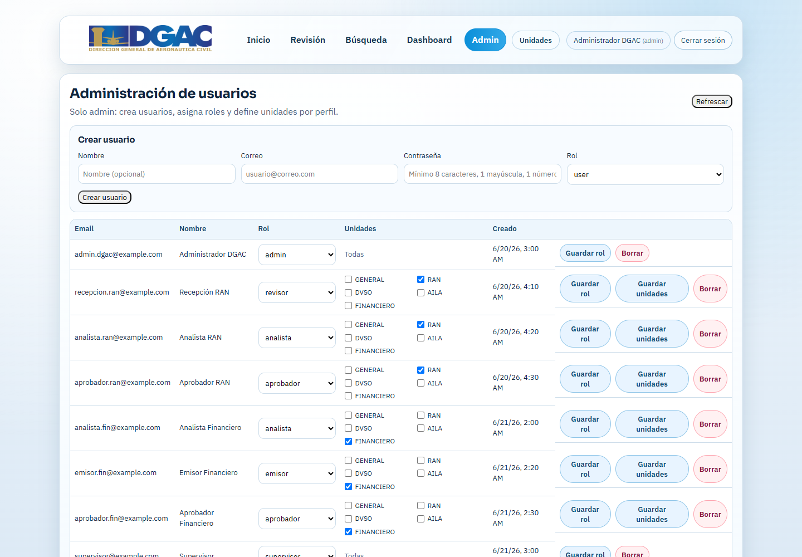
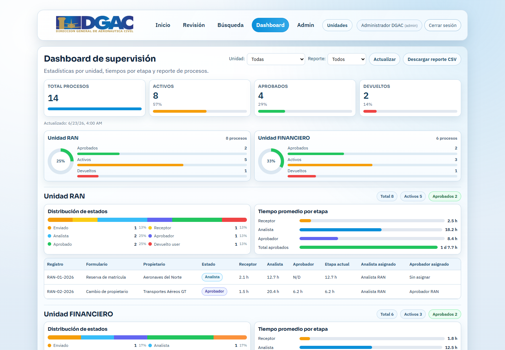
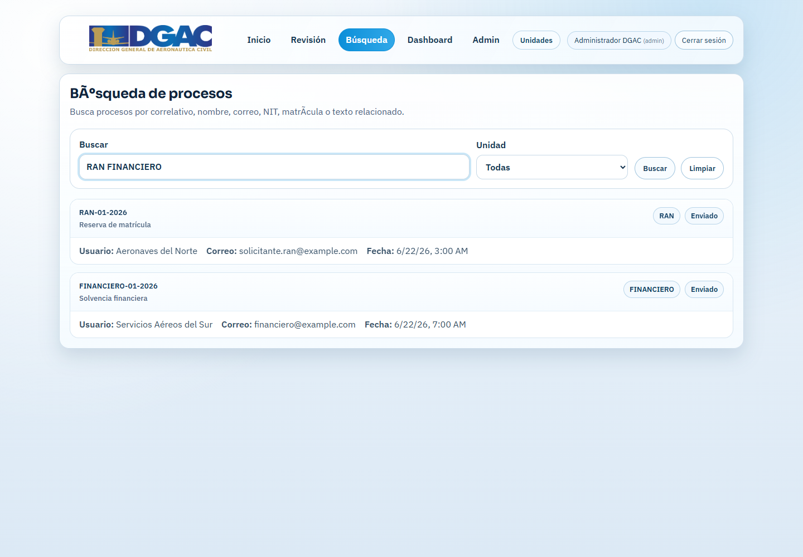

{width=42%}

Guía operativa para administradores del portal de trámites DGAC. Este documento explica cómo administrar usuarios, roles, unidades de acceso, supervisar procesos, consultar trámites y aplicar buenas prácticas de mantenimiento.

```{=openxml}
<w:p><w:r><w:br w:type="page"/></w:r></w:p>
```

# 1. Objetivo y alcance

Este manual está dirigido al personal con rol **admin** y a usuarios autorizados de supervisión. Su finalidad es mantener el sistema operativo, controlar accesos, apoyar a las unidades internas y consultar información general de procesos.

El administrador puede:

- Crear usuarios institucionales.
- Asignar roles.
- Definir unidades permitidas por usuario.
- Actualizar roles y permisos.
- Eliminar usuarios cuando corresponda.
- Consultar el dashboard de supervisión.
- Usar la búsqueda de procesos.
- Coordinar respaldos, restauraciones y revisiones técnicas básicas.

> **Importante:** El rol administrador tiene acceso sensible. Debe usarse únicamente para gestión del sistema, soporte autorizado y control institucional.

# 2. Acceso del administrador

1. Ingrese al portal con su correo y contraseña institucional.
2. Verifique que en la barra superior aparezca el usuario con rol **admin**.
3. Utilice las opciones principales:
   - **Admin:** gestión de usuarios.
   - **Dashboard:** supervisión estadística.
   - **Búsqueda:** consulta de procesos.
   - **Revisión:** apoyo operativo en trámites internos cuando corresponda.
   - **Unidades:** acceso a formularios disponibles.
4. Cierre sesión al finalizar.

## 2.1 Recomendaciones de seguridad

- No comparta credenciales.
- No use cuentas admin para pruebas de usuarios externos.
- Cree cuentas individuales; evite cuentas compartidas.
- Revise cuidadosamente el rol y la unidad antes de guardar cambios.
- Elimine o cambie permisos de usuarios que ya no deban acceder al sistema.

```{=openxml}
<w:p><w:r><w:br w:type="page"/></w:r></w:p>
```

# 3. Administración de usuarios

La pantalla **Admin** permite crear usuarios, asignar roles, definir unidades de acceso y actualizar usuarios existentes.

{width=92%}

## 3.1 Crear un usuario

1. Entre a **Admin**.
2. En la sección **Crear usuario**, complete:
   - **Nombre:** nombre del usuario o cargo.
   - **Correo:** correo institucional.
   - **Contraseña:** clave temporal segura.
   - **Rol:** perfil que tendrá el usuario.
3. Si el rol trabaja por unidad, seleccione las unidades permitidas.
4. Pulse **Crear usuario**.
5. Informe al usuario que debe cambiar o resguardar su contraseña según el procedimiento interno.

## 3.2 Política mínima de contraseña

La contraseña debe tener:

- Al menos 8 caracteres.
- Al menos una letra mayúscula.
- Al menos un número.
- Al menos un carácter especial, por ejemplo: `!`, `@`, `#`, `$`, `%`.

Ejemplo de formato válido: `Temporal2026!`

> **Buena práctica:** No reutilice contraseñas temporales. Si se entrega una clave inicial, debe enviarse por un canal seguro.

# 4. Roles del sistema

Los roles determinan qué puede ver y ejecutar cada usuario.

| Rol | Uso principal |
|---|---|
| user | Usuario externo que crea solicitudes. |
| revisor | Recepción o revisión inicial de procesos. |
| analista | Revisión documental y técnica del proceso. |
| emisor | Emisión o carga de documentos finales cuando el flujo lo requiere. |
| aprobador | Aprobación o devolución de procesos revisados. |
| avsec_financiero | Consulta autorizada para documentos financieros específicos. |
| supervisor | Consulta de dashboard y reportes de supervisión. |
| admin | Administración completa de usuarios y soporte del sistema. |

También existen roles especializados para unidades como AILA y DVSO. Si el administrador no los utiliza en la operación actual, no debe asignarlos sin confirmación del área responsable.

## 4.1 Roles recomendados para RAN

| Puesto operativo | Rol recomendado | Unidad |
|---|---|---|
| Recepción RAN | revisor | RAN |
| Analista RAN | analista | RAN |
| Aprobador RAN | aprobador | RAN |
| Supervisor RAN | supervisor | RAN o las unidades autorizadas |

## 4.2 Roles recomendados para Financiero

| Puesto operativo | Rol recomendado | Unidad |
|---|---|---|
| Recepción Financiero | revisor | FINANCIERO |
| Analista Financiero | analista | FINANCIERO |
| Emisor Financiero | emisor | FINANCIERO |
| Aprobador Financiero | aprobador | FINANCIERO |
| Consulta AVSEC Financiero | avsec_financiero | FINANCIERO |

```{=openxml}
<w:p><w:r><w:br w:type="page"/></w:r></w:p>
```

# 5. Unidades de acceso

Las unidades de acceso limitan qué procesos puede ver un usuario interno.

Un usuario con rol operativo puede tener acceso a:

- **GENERAL**
- **RAN**
- **FINANCIERO**
- **AILA**
- **DVSO**

En este manual se recomienda concentrar la operación en **RAN** y **FINANCIERO**, de acuerdo con los manuales de usuario e internos ya elaborados.

## 5.1 Actualizar unidades de un usuario

1. Ubique al usuario en la tabla.
2. Marque o desmarque las unidades correspondientes.
3. Pulse **Guardar unidades**.
4. Confirme que el cambio se mantenga después de refrescar.

## 5.2 Actualizar rol

1. Ubique al usuario en la tabla.
2. Seleccione el nuevo rol.
3. Pulse **Guardar rol**.
4. Si el nuevo rol requiere unidades, revise que tenga al menos una unidad seleccionada.

> **Precaución:** Cambiar un rol puede hacer que el usuario deje de ver procesos asignados o que obtenga acceso a bandejas adicionales. Realice cambios solo con autorización.

# 6. Eliminación de usuarios

El botón **Borrar** elimina el usuario seleccionado.

Antes de eliminar:

- Confirme que el usuario ya no labora o ya no debe acceder.
- Revise si tiene procesos asignados.
- Si tiene procesos activos, reasígnelos antes de eliminarlo.
- Evite eliminar cuentas si solo se requiere retirar acceso temporal; en ese caso, cambie rol o coordine bloqueo según política institucional.

> **Recomendación:** Para trazabilidad, es preferible documentar internamente quién solicitó la eliminación y la fecha del cambio.

```{=openxml}
<w:p><w:r><w:br w:type="page"/></w:r></w:p>
```

# 7. Dashboard de supervisión

La pantalla **Dashboard** muestra estadísticas por unidad, procesos activos, aprobados, devueltos, tiempos promedio por etapa y reporte CSV.

{width=92%}

## 7.1 Indicadores principales

- **Total procesos:** cantidad total registrada para el filtro actual.
- **Activos:** procesos en curso.
- **Aprobados:** procesos aprobados.
- **Devueltos:** procesos devueltos al usuario o a una etapa anterior.

## 7.2 Filtros

1. Use **Unidad** para consultar todas las unidades o una unidad específica.
2. Use **Reporte** para elegir entre todos los procesos o solo activos.
3. Pulse **Actualizar** para recargar los datos.
4. Pulse **Descargar reporte CSV** para generar un archivo de consulta.

## 7.3 Uso recomendado

- Revisar cargas de trabajo por unidad.
- Detectar etapas con mayor tiempo promedio.
- Identificar procesos devueltos.
- Preparar reportes internos.
- Dar seguimiento a RAN y Financiero sin entrar proceso por proceso.

# 8. Búsqueda de procesos

La pantalla **Búsqueda** permite consultar procesos por correlativo, nombre, correo, NIT, matrícula o texto relacionado.

{width=92%}

## 8.1 Buscar un proceso

1. Ingrese a **Búsqueda**.
2. Escriba el dato a consultar:
   - Correlativo.
   - Nombre del solicitante.
   - Correo.
   - NIT.
   - Matrícula.
   - Palabra relacionada con el trámite.
3. Seleccione la unidad, si desea limitar la consulta.
4. Pulse **Buscar**.
5. Revise los resultados mostrados.

## 8.2 Cuándo usar búsqueda

- Cuando un usuario reporta que no encuentra su trámite.
- Cuando una unidad necesita ubicar un proceso por correlativo.
- Cuando se requiere revisar asignaciones.
- Cuando se necesita confirmar el estado general de una solicitud.

> **Nota:** Si un proceso no aparece, revise si el usuario tiene permisos de unidad, si el texto buscado está escrito correctamente y si el proceso fue creado en la unidad esperada.

```{=openxml}
<w:p><w:r><w:br w:type="page"/></w:r></w:p>
```

# 9. Soporte operativo frecuente

## 9.1 Usuario no puede iniciar sesión

1. Confirme que el correo esté registrado.
2. Verifique que el usuario use el correo correcto.
3. Si el usuario externo no verificó su correo, solicite que complete la verificación.
4. Si olvidó la contraseña, use el flujo de recuperación.
5. Si es usuario interno, el administrador puede crear una nueva cuenta o coordinar restablecimiento según política interna.

## 9.2 Usuario interno no ve procesos

Revise:

- Rol asignado.
- Unidad de acceso.
- Si el proceso está asignado a otro responsable.
- Si el proceso ya fue entregado o finalizado.
- Si el usuario está consultando la bandeja correcta.

## 9.3 No aparecen analistas, emisores o aprobadores

Revise que existan usuarios con:

- Rol correcto.
- Unidad correcta.
- Cuenta activa.

Ejemplo: para enviar un proceso financiero a emisor, debe existir al menos un usuario con rol **emisor** y unidad **FINANCIERO**.

## 9.4 Un PDF no abre

1. Recargue la pantalla.
2. Confirme que el usuario tenga permisos del proceso.
3. Verifique si el documento realmente fue cargado.
4. Pruebe desde otro navegador autorizado.
5. Si persiste, escale a soporte técnico para revisar backend, almacenamiento y logs.

# 10. Mantenimiento básico del sistema

El administrador funcional no necesariamente ejecuta comandos técnicos, pero sí debe conocer qué elementos deben revisarse con informática.

## 10.1 Componentes principales

- **Frontend:** interfaz Angular del portal.
- **Backend:** API Node/Express.
- **Base de datos:** PostgreSQL, base `formulario`.
- **Variables de entorno:** archivo `.env` del backend.
- **Correo:** configuración SMTP para verificación, recuperación y notificaciones.
- **reCAPTCHA:** protección de login/registro/recuperación.

## 10.2 Verificaciones recomendadas

- Confirmar que el frontend cargue correctamente.
- Confirmar que el backend responda.
- Revisar que la base de datos esté activa.
- Probar inicio de sesión con usuario interno.
- Crear una solicitud de prueba solo en ambiente autorizado.
- Confirmar recepción de correos transaccionales.
- Validar que las unidades RAN y Financiero estén visibles para los roles esperados.

```{=openxml}
<w:p><w:r><w:br w:type="page"/></w:r></w:p>
```

# 11. Respaldo y restauración de base de datos

La base de datos contiene usuarios, procesos, documentos relacionados, bitácoras y estados. Debe respaldarse con frecuencia.

## 11.1 Recomendaciones de respaldo

- Realizar respaldos antes de actualizaciones.
- Guardar respaldos en ubicación segura.
- Registrar fecha, responsable y versión del sistema.
- Probar restauraciones en ambiente de prueba antes de producción.
- No compartir respaldos por canales no autorizados.

## 11.2 Restauración

Al restaurar:

1. Confirme que el archivo corresponda al ambiente correcto.
2. Valide la versión de PostgreSQL.
3. Restaure sobre una base vacía cuando sea posible.
4. Si restaura sobre una base existente, pueden aparecer errores por objetos duplicados.
5. Después de restaurar, revise usuarios, trámites y bitácoras.

> **Ejemplo de error común:** Si durante la restauración aparece que una restricción, tabla o índice “ya existe”, normalmente significa que se está restaurando sobre una base que ya tenía estructura creada. En ese caso, coordine con soporte técnico para limpiar/recrear la base o usar opciones de restauración adecuadas.

# 12. Control de cambios

Antes de modificar roles o permisos, registre internamente:

- Fecha del cambio.
- Usuario afectado.
- Rol anterior.
- Rol nuevo.
- Unidades asignadas.
- Persona que autorizó el cambio.
- Motivo del cambio.

Esta práctica ayuda a resolver dudas posteriores sobre acceso, visibilidad de procesos y responsabilidades.

# 13. Buenas prácticas administrativas

- Mantenga el menor número posible de usuarios con rol **admin**.
- Asigne acceso solo a las unidades necesarias.
- Revise periódicamente usuarios inactivos.
- No use usuarios personales para pruebas masivas.
- Documente cambios sensibles.
- Revise el dashboard al inicio de cada jornada operativa.
- Capacite a cada rol con el manual correspondiente.
- Evite cambios de permisos mientras un proceso está en revisión, salvo que sea necesario.

# 14. Escalamiento a soporte técnico

Escale a informática cuando ocurra alguno de estos casos:

- El portal no carga.
- La API no responde.
- No se conecta la base de datos.
- No se envían correos.
- reCAPTCHA bloquea todos los accesos.
- Los archivos PDF no se descargan.
- La restauración de base de datos falla.
- Aparecen errores repetidos en consola o servidor.

Al reportar, incluya:

- Fecha y hora.
- Usuario afectado.
- Pantalla donde ocurre.
- Acción realizada.
- Mensaje de error.
- Captura de pantalla.
- Correlativo del proceso, si aplica.

# 15. Datos del manual

- **Documento:** Manual de Administrador del Sistema DGAC.
- **Versión:** 1.0.
- **Fecha:** junio de 2026.
- **Alcance:** administración de usuarios, roles, unidades, dashboard, búsqueda, mantenimiento funcional, respaldo y soporte.

**Fin del documento.**
