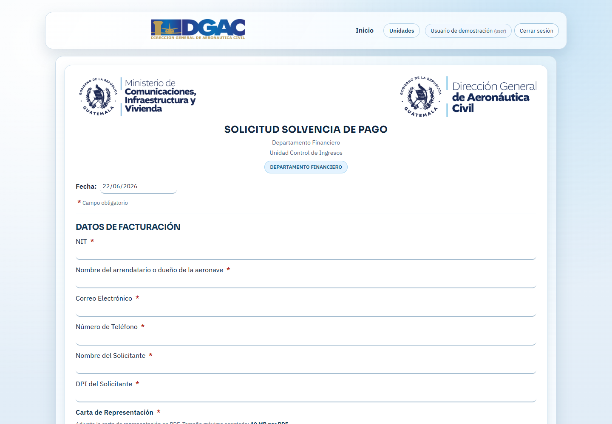

{width=42%}

Guía para crear una cuenta, presentar solicitudes y consultar el avance de sus gestiones.

```{=openxml}
<w:p><w:r><w:br w:type="page"/></w:r></w:p>
```

# 1. Acerca de este manual

Este manual está dirigido a personas y empresas que utilizan el sistema de trámites de la DGAC para presentar solicitudes, adjuntar documentos y consultar el avance de sus gestiones.

## 1.1 Antes de comenzar

- Utilice una computadora o dispositivo con conexión estable a Internet.
- Tenga acceso a un correo electrónico activo; allí recibirá enlaces de verificación y recuperación.
- Prepare los documentos solicitados en formato PDF y respete el tamaño máximo mostrado en cada formulario.
- Use información que coincida con sus documentos oficiales y revise los datos antes de guardar.

## 1.2 Recorrido general

1. Crear y verificar la cuenta de usuario.
2. Iniciar sesión con correo y contraseña.
3. Elegir la unidad y el trámite correspondiente.
4. Completar los campos y adjuntar los documentos requeridos.
5. Guardar la solicitud y conservar el correlativo asignado.
6. Consultar el estado, atender correcciones y descargar documentos cuando estén disponibles.

> **Importante:** Los campos marcados con asterisco (*) son obligatorios. El sistema no permitirá guardar una solicitud incompleta.

```{=openxml}
<w:p><w:r><w:br w:type="page"/></w:r></w:p>
```

# 2. Crear una cuenta

1. Abra el portal de trámites y seleccione la pestaña **Crear cuenta**.
2. Escriba su nombre completo, correo electrónico y una contraseña segura.
3. Pulse **Crear cuenta**.
4. Revise su correo electrónico y abra el enlace de verificación enviado por el sistema.

> **Contraseña:** Debe tener al menos 8 caracteres e incluir una letra mayúscula, un número y un carácter especial, por ejemplo: ! @ # $ %.

{width=88%}

```{=openxml}
<w:p><w:r><w:br w:type="page"/></w:r></w:p>
```

# 3. Iniciar sesión

1. Seleccione **Iniciar sesión**.
2. Ingrese el correo electrónico registrado.
3. Escriba su contraseña.
4. Complete la verificación reCAPTCHA cuando aparezca.
5. Pulse **Entrar**.

{width=88%}

> **Si no puede entrar:** Confirme que el correo fue verificado y que no haya espacios antes o después del correo. Si olvidó la contraseña, utilice el enlace correspondiente.

```{=openxml}
<w:p><w:r><w:br w:type="page"/></w:r></w:p>
```

# 4. Conocer la pantalla de inicio

Al iniciar sesión verá el nombre del usuario, el botón **Cerrar sesión**, el acceso **Inicio** y el menú **Unidades**. La pantalla Inicio muestra las gestiones realizadas y su avance.

{width=78%}

## 4.1 Menú Unidades

Coloque el puntero sobre **Unidades** y seleccione **RAN** o **Financiero**. Después, elija el trámite específico que desea realizar.

```{=openxml}
<w:p><w:r><w:br w:type="page"/></w:r></w:p>
```

# 5. Elegir un proceso de RAN o Financiero

Seleccione la unidad responsable del trámite. La disponibilidad puede variar según la configuración institucional.

- **RAN:** reserva, prórroga o cesión de matrícula; certificaciones; y trámites UAV/RPA.
- **Financiero:** solicitud de solvencia financiera y solicitud de contraseña de pago de otros rubros.

## 5.1 Reglas generales de llenado

- Complete todos los campos obligatorios identificados con asterisco (*).
- Seleccione correctamente el tipo de persona, gestión o permiso.
- Escriba teléfonos, NIT, matrícula y fechas con el formato solicitado.
- No cierre la pestaña mientras carga documentos o guarda la solicitud.

{width=86%}

```{=openxml}
<w:p><w:r><w:br w:type="page"/></w:r></w:p>
```

# 6. Adjuntar documentos y guardar

1. Ubique cada sección de documentos requeridos.
2. Pulse **Seleccionar PDF** y elija el archivo correspondiente.
3. Verifique que el nombre del archivo aparezca en pantalla.
4. Repita el proceso para todos los documentos obligatorios.
5. Revise la información y pulse **Guardar** una sola vez.
6. Espere el mensaje de confirmación y anote el correlativo asignado.

{width=86%}

> **Archivos PDF:** En el ejemplo, el límite indicado es de 10 MB por PDF. Si otro formulario muestra un límite diferente, prevalece el valor presentado en pantalla.

```{=openxml}
<w:p><w:r><w:br w:type="page"/></w:r></w:p>
```

# 7. Solicitudes del Departamento Financiero

El módulo Financiero permite seleccionar la gestión correspondiente y completar los datos de facturación. Lea el título del formulario antes de comenzar para confirmar que eligió la solicitud correcta.

- Ingrese NIT, nombre del arrendatario o dueño de la aeronave y datos de contacto.
- Complete los datos del solicitante exactamente como aparecen en su documento.
- Adjunte la carta de representación y los documentos que solicite la gestión.
- Después del procesamiento, revise **Inicio** para descargar la boleta o el documento disponible.

{width=86%}

```{=openxml}
<w:p><w:r><w:br w:type="page"/></w:r></w:p>
```

# 8. Consultar el estado de una gestión

Abra **Inicio** para consultar sus solicitudes. Las gestiones se agrupan por unidad y muestran el correlativo, estado, fecha y porcentaje de avance.

{width=90%}

## 8.1 Información mostrada en cada proceso

- **Nombre del trámite:** identifica la gestión presentada.
- **Correlativo:** código único utilizado para consultar o solicitar asistencia sobre el proceso.
- **Estado:** indica la etapa actual, por ejemplo Solicitud enviada o En revisión por analista.
- **Datos principales:** muestran el solicitante, registro, matrícula y fecha de creación.
- **Barra de avance:** representa visualmente el porcentaje completado del trámite.

> **Nota:** Los nombres, matrículas y correlativos de la Figura 7 son datos ficticios utilizados únicamente para explicar la pantalla.

- **Actualizar:** vuelve a consultar la información más reciente.
- **Realizar correcciones:** aparece cuando la unidad devuelve la solicitud y muestra el motivo.
- **Descargar formulario:** aparece cuando el documento aprobado está disponible.
- **Descargar boleta de pago:** aparece en los procesos financieros que ya cuentan con boleta.
- **Descargar permiso o documento firmado:** aparece cuando la unidad publica el documento final.
- **Calificar servicio:** permite valorar una gestión finalizada.

## 8.2 Atender una corrección

1. Lea completamente el motivo mostrado en la tarjeta de la gestión.
2. Pulse **Realizar correcciones**.
3. Modifique únicamente los datos o documentos solicitados.
4. Revise el formulario y vuelva a enviarlo.

> **Correlativo:** Conserve el código asignado. Facilita la identificación del trámite cuando solicite asistencia.

```{=openxml}
<w:p><w:r><w:br w:type="page"/></w:r></w:p>
```

# 9. Recuperar la contraseña

1. En la pantalla de acceso pulse **Olvidé mi contraseña**.
2. Ingrese el correo registrado y complete reCAPTCHA si aparece.
3. Pulse **Enviar enlace**.
4. Abra el mensaje recibido y siga el enlace para crear una contraseña nueva.
5. Confirme la nueva contraseña e inicie sesión.

## 9.1 Seguridad de la cuenta

- No comparta su contraseña ni los enlaces de recuperación.
- Cierre la sesión al utilizar equipos compartidos.
- No envíe documentos personales por medios distintos a los indicados por la DGAC.
- Verifique que se encuentra en el dominio institucional antes de ingresar credenciales.

## 9.2 Problemas frecuentes

- **No llega el correo:** revise Spam o Correo no deseado y confirme que escribió correctamente la dirección.
- **No se carga un PDF:** confirme que sea PDF, que no esté dañado y que cumpla el límite de tamaño.
- **El formulario no guarda:** revise los campos con asterisco y los mensajes en color rojo.
- **La información no cambia:** pulse Actualizar en Inicio y espere unos segundos.

```{=openxml}
<w:p><w:r><w:br w:type="page"/></w:r></w:p>
```

# 10. Asistencia y control de versión

Cuando solicite asistencia, indique su nombre, correo registrado, correlativo del trámite, unidad responsable y una descripción breve del inconveniente. No envíe contraseñas.

> **Evidencia útil:** Si es posible, adjunte una captura del mensaje de error sin mostrar información personal sensible.

## 10.1 Datos del manual

- **Documento:** Manual de Usuario Externo - Sistema de Trámites DGAC.
- **Versión:** 1.0.
- **Fecha:** junio de 2026.
- **Alcance:** registro, ingreso, presentación, seguimiento, correcciones y descargas de procesos RAN y Financiero para usuarios externos.

**Fin del documento.**
