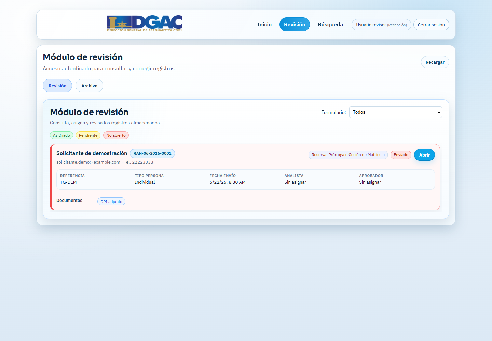
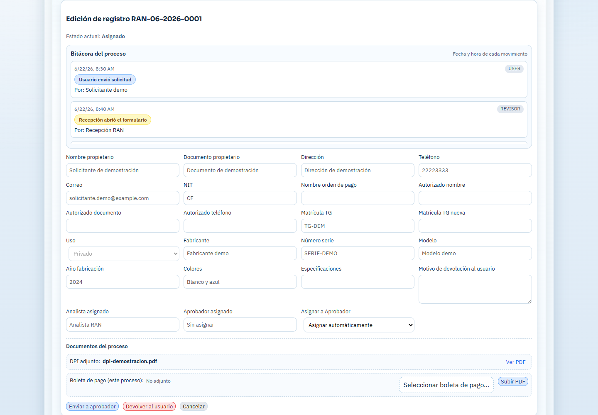
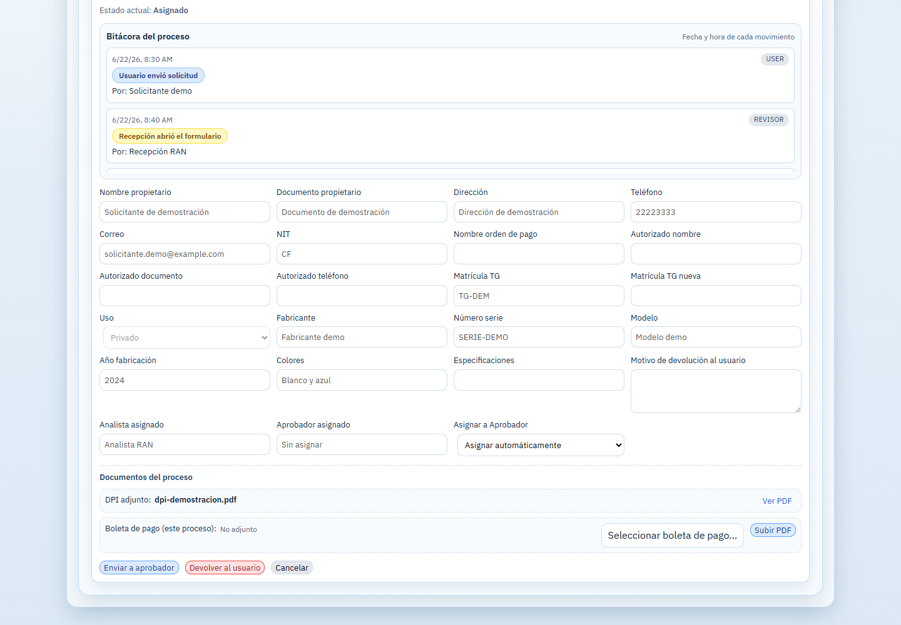
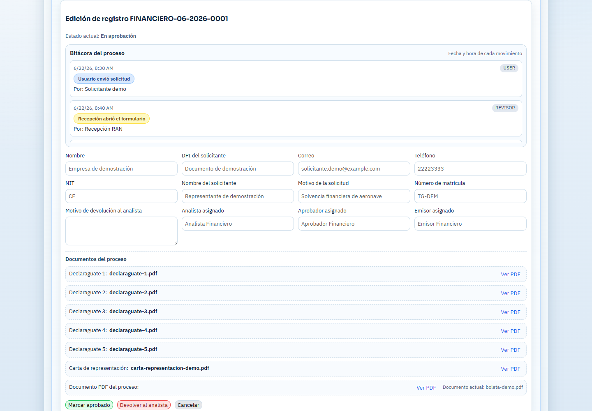
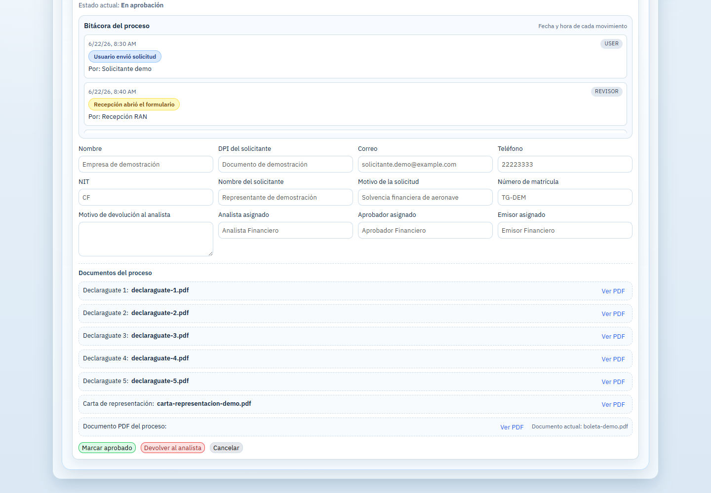

{width=42%}

Guía operativa para recepción, analistas, emisores, aprobadores y personal autorizado de RAN y Financiero.

```{=openxml}
<w:p><w:r><w:br w:type="page"/></w:r></w:p>
```

# 1. Objetivo y alcance

Este manual explica el uso interno del módulo de revisión para los procesos del Registro Aeronáutico Nacional (RAN) y del Departamento Financiero. Describe la recepción, asignación, revisión documental, devolución, aprobación, emisión final, entrega y consulta del historial.

## 1.1 Acceso al sistema

1. Ingrese al portal con el correo y la contraseña institucionales.
2. Seleccione **Revisión** en la barra superior.
3. Confirme que el usuario muestre el rol y la unidad correctos.
4. Utilice **Recargar** cuando necesite consultar cambios recientes.

> **Importante:** Cada usuario solamente debe trabajar los procesos asignados a su rol y unidad. No comparta credenciales ni descargue documentos en equipos no autorizados.

## 1.2 Elementos principales

- **Revisión:** bandeja de procesos pendientes o asignados.
- **Archivo:** procesos entregados o finalizados.
- **Dashboard:** métricas disponibles para aprobadores autorizados.
- **Procesos aprobados:** historial financiero disponible para el rol correspondiente.
- **Búsqueda:** consulta de procesos dentro de las unidades asignadas.

```{=openxml}
<w:p><w:r><w:br w:type="page"/></w:r></w:p>
```

# 2. Roles y responsabilidades

## 2.1 Recepción

- Abre las solicitudes nuevas.
- Verifica que correspondan a la unidad correcta.
- Consulta los documentos iniciales.
- Asigna el proceso a un analista.
- Marca como entregados los procesos RAN aprobados.
- Marca como finalizados los procesos financieros que cumplan las condiciones del flujo.

## 2.2 Analista

- Revisa los datos y documentos del solicitante.
- Consulta la bitácora del proceso.
- Registra observaciones cuando corresponda.
- Devuelve el proceso al usuario indicando un motivo claro o lo envía a la siguiente etapa.
- En RAN, puede cargar el PDF del proceso y enviarlo al aprobador.
- En Financiero, traslada las solicitudes de solvencia al emisor y gestiona la boleta en los procesos de contraseña de pago.

## 2.3 Emisor financiero

- Recibe del analista las solicitudes financieras que requieren emisión.
- Revisa los datos, documentos y PDF del proceso.
- Envía la solicitud al aprobador.
- Después de la validación del aprobador, carga el documento firmado final.

## 2.4 Aprobador

- Revisa la solicitud, la bitácora y los documentos disponibles.
- Aprueba el proceso o lo devuelve con un motivo.
- En Financiero no carga el documento firmado final; después de aprobar, el proceso regresa al emisor para completar la emisión.

## 2.5 AVSEC Financiero

- Consulta el documento firmado cuando el proceso financiero autorizado lo requiere.
- No modifica las asignaciones ni sustituye las acciones del analista, emisor o aprobador.

```{=openxml}
<w:p><w:r><w:br w:type="page"/></w:r></w:p>
```

# 3. Bandeja de revisión y recepción

La bandeja presenta cada proceso como una tarjeta con solicitante, correlativo, gestión, estado, referencia, fecha de envío, responsables asignados y documentos disponibles.

{width=90%}

## 3.1 Interpretar los colores

- **Rojo — No abierto:** proceso nuevo que todavía no ha sido abierto por recepción.
- **Amarillo — Pendiente:** proceso abierto que requiere una acción del rol actual.
- **Verde — Asignado:** proceso que ya tiene responsable o avanzó a la etapa correspondiente.

## 3.2 Abrir y asignar un proceso

1. Localice el correlativo y confirme la gestión.
2. Pulse **Abrir**.
3. Revise los datos principales y documentos adjuntos.
4. Seleccione al analista de la unidad.
5. Pulse **Asignar analista**.
6. Confirme que el nombre del analista aparezca en el proceso.

> **Asignación:** Cuando un proceso se asigna a otra persona, deja de mostrarse en la bandeja del usuario anterior y aparece en la bandeja del responsable asignado.

```{=openxml}
<w:p><w:r><w:br w:type="page"/></w:r></w:p>
```

# 4. Flujo interno de RAN

El flujo general de RAN es:

**Usuario externo → Recepción → Analista → Aprobador → Recepción para entrega**

## 4.1 Recepción RAN

1. Abre la solicitud.
2. Verifica correlativo, tipo de trámite y documentos iniciales.
3. Asigna un analista con acceso a RAN.

## 4.2 Analista RAN

1. Abre el proceso asignado.
2. Lee la bitácora para conocer los movimientos previos.
3. Comprueba los datos del propietario, aeronave y gestión solicitada.
4. Abre cada PDF desde **Documentos del proceso**.
5. Si existen errores, escribe un motivo específico y pulsa **Devolver al usuario**.
6. Si la información es correcta, carga el PDF requerido cuando corresponda y selecciona al aprobador.
7. Pulsa **Enviar a aprobador**.

{width=90%}

```{=openxml}
<w:p><w:r><w:br w:type="page"/></w:r></w:p>
```

# 5. Acciones del analista RAN

La parte inferior del registro reúne los documentos y las acciones disponibles para el analista.

{width=90%}

## 5.1 Cargar un PDF

1. Pulse el selector de archivo correspondiente.
2. Elija únicamente un archivo PDF válido.
3. Verifique el nombre del archivo.
4. Pulse **Subir PDF** y espere la confirmación.
5. No envíe el proceso a la siguiente etapa hasta confirmar que el documento aparece cargado.

## 5.2 Devolver al usuario

1. Escriba el motivo de devolución de forma clara y concreta.
2. Indique qué dato o documento debe corregirse.
3. Pulse **Devolver al usuario**.
4. El proceso regresará al usuario externo para corrección y reenvío.

## 5.3 Enviar al aprobador

1. Seleccione un aprobador de RAN o utilice la asignación automática.
2. Confirme que la revisión y los documentos estén completos.
3. Pulse **Enviar a aprobador**.

> **Precaución:** Una vez trasladado a la siguiente etapa, algunos documentos quedan bloqueados hasta que el proceso regrese al analista.

```{=openxml}
<w:p><w:r><w:br w:type="page"/></w:r></w:p>
```

# 6. Aprobación y entrega de RAN

## 6.1 Aprobador RAN

1. Abra el proceso asignado.
2. Revise la bitácora, datos, observaciones y PDFs.
3. Si requiere cambios, escriba el motivo y pulse **Devolver al analista**.
4. Si todo está correcto, pulse **Marcar aprobado**.

## 6.2 Recepción RAN

Después de la aprobación, recepción vuelve a visualizar el proceso listo para entrega.

1. Confirme que el proceso está aprobado.
2. Verifique que el documento correspondiente esté disponible.
3. Realice la entrega según el procedimiento institucional.
4. Pulse **Marcar entregado**.

> **Resultado:** El proceso desaparece de la bandeja activa y queda disponible en **Archivo**. El usuario externo puede consultar el estado y descargar los documentos habilitados.

```{=openxml}
<w:p><w:r><w:br w:type="page"/></w:r></w:p>
```

# 7. Flujo interno de Financiero

Para solicitudes de solvencia, el flujo general es:

**Usuario externo → Recepción → Analista → Emisor → Aprobador → Emisor → Recepción para finalización**

## 7.1 Recepción Financiero

1. Abre la solicitud nueva.
2. Verifica el tipo de gestión y los documentos presentados.
3. Asigna al analista financiero correspondiente.

## 7.2 Analista Financiero

1. Comprueba datos de facturación, solicitante, matrícula y documentos.
2. Devuelve al usuario si falta información o documentación.
3. Selecciona un emisor financiero.
4. Pulsa **Enviar a emisor** cuando la revisión esté completa.

## 7.3 Emisor Financiero

1. Revisa la información trasladada por el analista.
2. Selecciona al aprobador de la unidad.
3. Pulsa **Enviar a aprobador**.
4. Después de la aprobación, recibe nuevamente el proceso.
5. Carga el documento firmado final; esta acción completa la aprobación operativa del documento.

## 7.4 Contraseña de pago de otros rubros

En este tipo de gestión, el analista carga la boleta de pago. El usuario externo puede descargarla y continuar con el pago correspondiente. El flujo puede finalizar sin pasar por todas las etapas de una solvencia financiera.

```{=openxml}
<w:p><w:r><w:br w:type="page"/></w:r></w:p>
```

# 8. Aprobador Financiero

La pantalla del aprobador muestra los datos del solicitante, responsables de cada etapa, documentos Declaraguate, carta de representación y PDF del proceso.

{width=90%}

## 8.1 Aprobar

1. Revise la bitácora y los documentos disponibles.
2. Confirme que el analista y el emisor correctos estén registrados.
3. Pulse **Marcar aprobado**.
4. El sistema devuelve el proceso al emisor para que cargue el documento firmado final.

## 8.2 Devolver

1. Escriba el motivo de devolución.
2. Pulse **Devolver al analista**.
3. El proceso regresa a la etapa de análisis para corrección.

{width=90%}

> **Regla del flujo:** El aprobador financiero no carga el documento firmado final. Esa tarea corresponde al emisor después de la aprobación.

```{=openxml}
<w:p><w:r><w:br w:type="page"/></w:r></w:p>
```

# 9. Documento final y finalización financiera

## 9.1 Emisor después de la aprobación

1. Abra el proceso aprobado que regresó a su bandeja.
2. Confirme que la aprobación aparece en la bitácora.
3. Seleccione el documento firmado final en PDF.
4. Pulse **Subir PDF**.
5. Verifique que el documento figure como cargado.

La carga realizada por el emisor deja disponible el documento para el usuario externo y para los roles autorizados.

## 9.2 Recepción

1. Confirme que el proceso cuenta con aprobación y documento final.
2. Complete la entrega o gestión administrativa correspondiente.
3. Pulse **Marcar finalizado**.

## 9.3 AVSEC Financiero

Cuando el proceso y los permisos lo permiten, el rol AVSEC Financiero puede abrir y consultar el documento firmado. Este rol no debe reasignar ni alterar el flujo de aprobación.

```{=openxml}
<w:p><w:r><w:br w:type="page"/></w:r></w:p>
```

# 10. Bitácora, documentos y estados

## 10.1 Bitácora

La bitácora registra fecha, hora, evento, rol y responsable de cada movimiento. Úsela para verificar asignaciones, devoluciones, aprobaciones y cargas de documentos.

## 10.2 Documentos

- Abra cada documento mediante **Ver PDF**.
- Confirme que el archivo corresponde a la etiqueta mostrada.
- No descargue ni comparta documentos fuera de los canales institucionales.
- Si un documento no abre, recargue la página y compruebe los permisos del rol.

## 10.3 Estados frecuentes

- **Enviado:** solicitud recibida del usuario externo.
- **Abierto / pendiente:** proceso revisado inicialmente y pendiente de acción.
- **Asignado:** proceso entregado a un responsable.
- **En emisor:** proceso financiero trasladado a emisión.
- **En aprobación:** proceso asignado a un aprobador.
- **Devuelto:** requiere corrección del usuario o del responsable anterior.
- **Aprobado:** validación completada.
- **Entregado / finalizado:** proceso cerrado operativamente.

```{=openxml}
<w:p><w:r><w:br w:type="page"/></w:r></w:p>
```

# 11. Dashboard, Archivo y procesos aprobados

## 11.1 Dashboard

Los aprobadores con acceso a RAN o Financiero pueden consultar métricas de procesos activos, pendientes de aprobación, aprobados, entregados y tiempos por etapa. La información se limita a las unidades asignadas al usuario.

## 11.2 Archivo

La pestaña **Archivo** muestra procesos entregados o finalizados. Utilícela para consultar datos y documentos históricos sin regresar el proceso a la bandeja activa.

## 11.3 Procesos aprobados

El aprobador financiero puede consultar el historial de procesos aprobados y abrir su detalle, responsables, documentos y bitácora.

> **Actualización automática:** El sistema actualiza las bandejas periódicamente. La selección y la posición de la página deberían conservarse durante el refresco.

```{=openxml}
<w:p><w:r><w:br w:type="page"/></w:r></w:p>
```

# 12. Buenas prácticas y solución de problemas

## 12.1 Buenas prácticas

- Revise correlativo y unidad antes de ejecutar una acción.
- Escriba motivos de devolución que permitan corregir el problema sin ambigüedad.
- Verifique el PDF antes de enviarlo a la siguiente etapa.
- Evite pulsar dos veces los botones de envío, aprobación o finalización.
- Use **Recargar** antes de reportar que un proceso no aparece.
- Cierre sesión al finalizar el trabajo.

## 12.2 Problemas frecuentes

- **No aparece un proceso:** confirme que está asignado a su usuario, rol y unidad.
- **No aparecen emisores o aprobadores:** verifique que existan usuarios configurados con acceso a la unidad.
- **No se puede subir el PDF:** confirme formato PDF, tamaño permitido y etapa actual.
- **No se puede aprobar:** revise que el proceso esté asignado al aprobador actual.
- **No se puede finalizar:** confirme que la aprobación y el documento final requeridos estén completos.
- **La pantalla no cambia:** pulse Recargar y vuelva a consultar la bitácora.

## 12.3 Datos del manual

- **Documento:** Manual de Usuarios Internos - RAN y Financiero.
- **Versión:** 1.0.
- **Fecha:** junio de 2026.
- **Alcance:** recepción, análisis, emisión, aprobación, devolución, entrega, finalización e historial.

**Fin del documento.**
